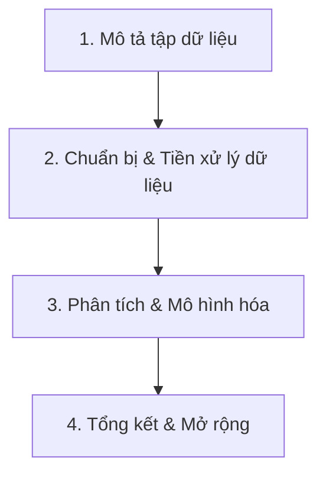

# KẾ HOẠCH CHI TIẾT & BÁO CÁO ĐỊNH HƯỚNG BÀI TẬP LỚN (BTL)
**Môn học:** Nền tảng lập trình cho phân tích và trực quan dữ liệu  
**Giảng viên:** ThS./TS. Lê Thành Sách | **Học kỳ:** 261 (Năm học 2026–2027)  
**Thời gian thực hiện:** 01 tháng (4 tuần)  
**Độ khó mục tiêu:** Mức độ Trung bình (Cân bằng giữa tính khả thi, thời gian thực hiện và tối ưu điểm số theo Rubric)

---

## 1. TỔNG QUAN YÊU CẦU & THANG ĐIỂM ĐÁNH GIÁ (RUBRIC)

### 1.1. Quy mô & Khối lượng theo hình thức tham gia
- **Làm cá nhân (2 loại dữ liệu):**
  - **Bài 1 (Bắt buộc):** Dữ liệu bảng (**Tabular Data**).
  - **Bài 2 (Tự chọn):** Chọn 1 trong 4 loại: **Text**, **Image**, **Multimodal**, hoặc **Time series**.
- **Làm theo nhóm 2–3 người (3 loại dữ liệu):**
  - **Bài 1 (Bắt buộc):** Dữ liệu bảng (**Tabular Data**).
  - **Bài 2 (Bắt buộc):** Dữ liệu văn bản (**Text Data**).
  - **Bài 3 (Tự chọn):** Chọn 1 trong: **Image**, **Multimodal**, hoặc **Time series**.

### 1.2. Thang điểm đánh giá (Rubric chi tiết)
| Thành phần đánh giá | Trọng số | Yêu cầu cốt lõi để đạt điểm tối đa |
| :--- | :---: | :--- |
| **Chất lượng & Hoàn thiện Notebook (.ipynb)** | **50%** | Chạy "Run all" mượt mà trên Google Colab không lỗi; code chuẩn OOP/hàm tái sử dụng; áp dụng đúng pipeline Scikit-learn; xử lý kỹ missing/outliers/scaling/encoding. |
| **Báo cáo & Trình bày Markdown** | **20%** | Mô tả bài toán rõ ràng; diễn giải ý nghĩa biểu đồ EDA; giải thích lý do chọn mô hình/siêu tham số; phân tích Confusion Matrix và Failure Analysis. |
| **Video Demo & Kỹ năng thuyết trình** | **15%** | Thời lượng 5–10 phút; giọng nói rõ ràng; demo luồng chạy code, kết quả trực quan và nhận xét rút ra từ thực nghiệm; upload YouTube (Public/Unlisted). |
| **Tính sáng tạo, Mở rộng, Tự động hóa** | **10%** | Tự crawl dữ liệu (với Text); so sánh baseline Scikit-learn với mô hình nâng cao (Pretrained/Transfer Learning/OpenCV); đóng gói Scikit-Learn Pipeline tự động. |
| **Hình thức nộp & Đường dẫn hợp lệ** | **5%** | Đúng hạn; share link Colab quyền "Editor" cho giảng viên; link YouTube hoạt động; điền đúng sheet quy định. |

---

## 2. CHIẾN LƯỢC LỰA CHỌN HƯỚNG ĐI (MỨC ĐỘ TRUNG BÌNH)

> **Tiêu chí chọn bài toán mức độ Trung bình:**  
> - **Không quá dễ:** Tuyệt đối tránh các *toy dataset* kinh điển (Titanic, Iris, MNIST, CIFAR-10) vì sẽ bị trừ điểm sáng tạo và vi phạm yêu cầu đề bài.
> - **Không quá khó:** Tránh các bài toán nặng về gán nhãn phức tạp (như Object Detection YOLO, Segmentation, 3D Reconstruction, Multimodal Transformer) vì dễ gây tràn RAM/GPU Colab, tốn hàng tuần dán nhãn thủ công và khó hoàn thành trong 1 tháng.
> - **Tối ưu điểm số:** Đạt trọn vẹn các yêu cầu kỹ thuật (Missing values, Categorical, Imbalanced, Pretrained, Tiếng Việt/Crawling) một cách bài bản, dễ giải thích trong Markdown và Video.

---

### PHẦN 1: DỮ LIỆU BẢNG (TABULAR) — [BẮT BUỘC]
* **Ràng buộc:** $\ge 2000$ mẫu, $\ge 10$ cột, có missing values, có biến categorical, biến numerical, ưu tiên dữ liệu mất cân bằng (imbalanced) và có outliers.

#### Đề xuất đề tài: **Dự đoán Khách hàng Rời bỏ Dịch vụ Ngân hàng / Viễn thông (Bank Customer Churn Prediction)**
- **Tập dữ liệu:** *Bank Customer Churn Dataset* hoặc *Telco Customer Churn* (từ Kaggle/UCI Machine Learning Repository).
  - Quy mô: ~10,000 dòng, 14–18 cột.
  - Cột định lượng (Numerical): Tuổi, Điểm tín dụng, Số dư tài khoản, Lương ước tính, Thời gian gắn bó... (thực hành **StandardScaler** / **RobustScaler**).
  - Cột định danh (Categorical): Quốc gia, Giới tính, Loại thẻ, Tình trạng kích hoạt... (thực hành **One-Hot Encoding**, **Ordinal Encoding**).
  - Đặc tính: Tỷ lệ Churn thường mất cân bằng (~20% rời bỏ, 80% ở lại) $\rightarrow$ cơ hội áp dụng kỹ thuật xử lý mất cân bằng (**SMOTE**, **Class Weights**).
  - Xử lý thiếu dữ liệu: Chủ động xử lý missing values ở các thuộc tính thu nhập/số dư (thực hành **SimpleImputer**, **KNNImputer**).
- **Mô hình triển khai:**
  - Baseline: Logistic Regression.
  - So sánh: Random Forest, Gradient Boosting (XGBoost/LightGBM).
  - Kỹ thuật nâng cao: Đóng gói toàn bộ vào `sklearn.pipeline.Pipeline` kết hợp `ColumnTransformer`, tìm siêu tham số bằng `GridSearchCV` hoặc `RandomizedSearchCV`.

---

### PHẦN 2: DỮ LIỆU VĂN BẢN (TEXT) — [KHUYẾN NGHỊ CHO BÀI TỰ CHỌN / BẮT BUỘC NẾU LÀ NHÓM]
* **Ràng buộc:** $\ge 2000$ mẫu, khuyến khích tiếng Việt, tự thu thập dữ liệu (crawling) được cộng điểm.

#### Đề xuất đề tài: **Phân loại Cảm xúc Đánh giá Sản phẩm / Dịch vụ Tiếng Việt (Vietnamese Product Review Sentiment Analysis)**
- **Nguồn dữ liệu:**
  - Tự crawl khoảng 2,500 – 3,000 bình luận/đánh giá từ Shopee, Tiki hoặc Google Maps Reviews (sử dụng script Python đơn giản với `BeautifulSoup` / API mở) $\rightarrow$ **Ăn trọn 10% điểm Sáng tạo & Crawling**.
  - Nhãn phân loại: Tích cực (Positive), Trung tính (Neutral), Tiêu cực (Negative) hoặc nhị phân (Hài lòng / Không hài lòng).
- **Quy trình xử lý:**
  - Tiền xử lý tiếng Việt: Chuẩn hóa Unicode tiếng Việt, viết thường, xóa teencode/ký tự đặc biệt/emojis, tách từ tiếng Việt bằng thư viện chuyên dụng (`underthesea` hoặc `pyvi`).
  - Vectorization: `TfidfVectorizer` (n-gram (1,2), min_df, max_features).
- **Mô hình triển khai:**
  - Mô hình Scikit-learn: Multinomial Naive Bayes, Logistic Regression, LinearSVC.
  - Phần mở rộng (Bonus): Thử nghiệm thêm mô hình Pretrained Transformer tiếng Việt dạng nhẹ (`phobert-base` fine-tuning 2-3 epochs hoặc dùng PhoBERT làm feature extractor) trên Colab GPU để so sánh hiệu năng giữa ML truyền thống và Deep Learning.

---

### PHẦN 3: DỮ LIỆU HÌNH ẢNH (IMAGE) — [DỰ PHÒNG CHO NHÓM 3 NGƯỜI HOẶC NẾU CHỌN THAY TEXT]
* **Ràng buộc:** $\ge 5000$ ảnh, $\ge 3$ lớp, kích thước cạnh ngắn $\ge 128$px, KHÔNG dùng toy dataset (MNIST/CIFAR), bắt buộc Pretrained DL (Feature extractor hoặc Fine-tuning), đối chiếu OpenCV.

#### Đề xuất đề tài: **Phân loại Tình trạng Bệnh trên Lá Cây (Plant Leaf Disease Classification)** hoặc **Phân loại Rác thải Tái chế (Garbage Classification)**
- **Tập dữ liệu:** Lấy từ Kaggle (*PlantVillage* trích xuất 4–5 lớp phổ biến hoặc *Garbage Classification Dataset* gồm: Cardboard, Glass, Metal, Paper, Plastic).
  - Quy mô: ~5,000 – 6,000 ảnh màu, 4–5 classes, độ phân giải gốc $256 \times 256$ px.
- **Quy trình xử lý:**
  - Data Augmentation: Horizontal Flip, Random Rotation, Color Jitter, Resize $224 \times 224$, Normalize theo chuẩn ImageNet.
  - Chia tập: Train (70%), Validation (15%), Test (15%) độc lập (tránh data leakage).
- **Mô hình triển khai:**
  - **Mô hình Pretrained (DL):** Dùng `MobileNetV3` hoặc `ResNet50` (PyTorch/Torchvision có sẵn).
    - Hướng thực hiện: Freeze backbone (đóng băng trọng số) $\rightarrow$ thêm Linear Classifier $\rightarrow$ Huấn luyện 5–10 epochs trên Colab T4 GPU (chạy trong ~5–10 phút).
  - **Đối chiếu OpenCV (Ăn điểm Rubric):** Dùng OpenCV trích xuất đặc trưng thủ công (**HOG** - Histogram of Oriented Gradients hoặc **Color Histograms**) $\rightarrow$ đưa vào mô hình Scikit-learn (**SVM / Random Forest**) để so sánh trực quan với kết quả của Pretrained CNN.

---

## 3. LỘ TRÌNH THỰC HIỆN CHI TIẾT TRONG 01 THÁNG (4 TUẦN)

```
[Tuần 1: Chuẩn bị & Dữ liệu] ──> [Tuần 2: Modeling & Thử nghiệm] ──> [Tuần 3: Tối ưu & Báo cáo MD] ──> [Tuần 4: Video Demo & Nộp bài]
```

### TUẦN 1: Xác định Đề tài, Thu thập & Khám phá Dữ liệu (EDA)
* **Mục tiêu:** Hoàn thành chọn đề tài, đăng ký Google Sheet với giảng viên, thu thập dữ liệu và hoàn thiện khâu tiền xử lý + EDA cơ bản.
* **Các đầu việc cụ thể:**
  - [ ] **Ngày 1–2:** Xác định thành viên (cá nhân hay nhóm) và đăng ký đề tài vào *Group and Dataset Registration Sheet* theo yêu cầu của thầy.
  - [ ] **Ngày 3–4:** 
    - **Tabular:** Tải dataset Churn/Credit, kiểm tra kích thước (>2000 dòng, >10 cột), kiểm tra missing values và kiểu dữ liệu.
    - **Text:** Viết script crawl 2500–3000 mẫu review Shopee/Tiki/Google Maps hoặc tải bộ dữ liệu tiếng Việt tương đương; lưu dưới dạng `data_reviews.csv`.
  - [ ] **Ngày 5–7:** Khởi tạo Notebook trên Google Colab:
    - Soạn thảo Markdown tổng quan: giới thiệu bài toán, ý nghĩa các trường dữ liệu.
    - Thực hiện EDA trực quan bằng **Matplotlib, Seaborn, Plotly**: biểu đồ phân bố nhãn, ma trận tương quan (Correlation Matrix Heatmap), biểu đồ Boxplot phát hiện outliers.

---

### TUẦN 2: Tiền xử lý Nâng cao & Huấn luyện Mô hình Cơ bản
* **Mục tiêu:** Xây dựng luồng tiền xử lý sạch sẽ (Pipeline) và huấn luyện baseline model với Scikit-learn.
* **Các đầu việc cụ thể:**
  - [ ] **Ngày 8–10 (Tabular):**
    - Viết hàm hoặc Pipeline xử lý Missing values (`SimpleImputer`/`KNNImputer`).
    - Phân chia: `train_test_split(..., test_size=0.2, stratify=y, random_state=42)`.
    - Chuẩn hóa: Numerical $\rightarrow$ `StandardScaler`/`RobustScaler`; Categorical $\rightarrow$ `OneHotEncoder`.
    - Đóng gói với `ColumnTransformer`.
    - Huấn luyện: Logistic Regression (Baseline) và Random Forest Classifier.
  - [ ] **Ngày 11–14 (Text):**
    - Viết module tiền xử lý văn bản tiếng Việt: làm sạch regex, chuyển chữ thường, loại bỏ stop words, tách từ bằng `underthesea.word_tokenize`.
    - Trích xuất đặc trưng bằng `TfidfVectorizer(max_features=5000, ngram_range=(1,2))`.
    - Huấn luyện mô hình phân loại: Naive Bayes (`MultinomialNB`), Logistic Regression, LinearSVC.

---

### TUẦN 3: Tối ưu hóa Siêu tham số, Mở rộng & Hoàn thiện Notebook
* **Mục tiêu:** Tinh chỉnh mô hình, bổ sung phần sáng tạo/mở rộng, hoàn thiện 100% phần Markdown phân tích trong các file `.ipynb`.
* **Các đầu việc cụ thể:**
  - [ ] **Ngày 15–17 (Tối ưu & Đánh giá):**
    - Tinh chỉnh siêu tham số với `GridSearchCV` / `RandomizedSearchCV` (đánh giá bằng K-Fold Cross Validation).
    - Tính toán toàn diện các metrics: **Accuracy, Precision, Recall, F1-score, ROC-AUC**.
    - Vẽ biểu đồ trực quan: **Confusion Matrix**, **ROC Curve**, biểu đồ **Feature Importance** (đặc trưng quan trọng nhất tác động đến dự đoán).
  - [ ] **Ngày 18–19 (Tính năng Mở rộng - Ăn điểm 10% Sáng tạo):**
    - *Với Tabular:* So sánh kỹ thuật xử lý mất cân bằng dữ liệu (Không xử lý vs. Áp dụng SMOTE vs. Class Weight).
    - *Với Text:* Tích hợp thử nghiệm mô hình Transformer nhẹ (PhoBERT) hoặc viết hàm suy luận (Inference Function) nhận chuỗi văn bản người dùng nhập và trả về phân loại cảm xúc.
    - *Với Image (nếu làm):* So sánh mô hình Pretrained MobileNetV3 với OpenCV HOG + SVM.
  - [ ] **Ngày 20–21 (Trau chuốt Markdown Notebook):**
    - Rà soát cấu trúc notebook theo đúng 4 mục chuẩn của Đề bài (Mục 5 PDF).
    - Bổ sung nhận xét phân tích chuyên sâu bên dưới mỗi biểu đồ và bảng kết quả.
    - Phân tích hạn chế của tập dữ liệu (như data bias, thiếu trường dữ liệu quan trọng) và hướng phát triển.
    - Đảm bảo nhấn nút **"Restart and Run All"** trên Colab chạy thông suốt từ đầu đến cuối không có bất kỳ lỗi nào.

---

### TUẦN 4: Quay Video Demo, Chuẩn bị Nộp bài & Thuyết trình
* **Mục tiêu:** Hoàn thiện video demo 5–10 phút, tải lên YouTube, kiểm tra toàn bộ link chia sẻ và nộp bài đúng hạn.
* **Các đầu việc cụ thể:**
  - [ ] **Ngày 22–24 (Xây dựng kịch bản & Quay video demo):**
    - Soạn kịch bản video (5–8 phút):
      1. *Giới thiệu (1 phút):* Thành viên, mục tiêu bài toán, mô tả tập dữ liệu.
      2. *Quy trình tiền xử lý & EDA (2 phút):* Trình chiếu các biểu đồ nổi bật, giải thích cách xử lý missing, encoding, scaling.
      3. *Huấn luyện & Kết quả (2–3 phút):* Trình bày bảng so sánh các mô hình, Confusion Matrix, mô hình tối ưu nhất.
      4. *Phần mở rộng & Demo suy luận (1–2 phút):* Nhập dữ liệu mới/câu text mới để mô hình dự đoán trực tiếp.
    - Quay màn hình bằng OBS Studio hoặc tính năng ghi hình có sẵn (Windows Game Bar / PowerPoint / Zoom).
  - [ ] **Ngày 25–26 (Upload & Kiểm tra Link):**
    - Upload video lên YouTube ở chế độ **Unlisted** (Không công khai) hoặc **Public** (Công khai). Kiểm tra âm thanh và độ phân giải ($\ge 1080p$).
    - Thiết lập quyền chia sẻ Google Colab: Chọn **"Anyone with the link can edit" (Bất kỳ ai có liên kết đều có quyền Chỉnh sửa)** để thầy Lê Thành Sách có thể chấm bài.
  - [ ] **Ngày 27–28 (Điền Sheet & Tổng kết):**
    - Điền đầy đủ thông tin vào sheet **Submission Links Sheet** theo thông báo của giảng viên.
    - Chuẩn bị slide tóm tắt 5–7 trang để trình bày trong buổi học cuối cùng của môn học.

---

## 4. CẤU TRÚC TIÊU CHUẨN CỦA FILE NOTEBOOK (.IPYNB)
Mỗi loại dữ liệu phải nằm trong một notebook riêng biệt trên Google Colab và tuân thủ chặt chẽ cấu trúc 4 phần sau:



### Phần 1: Mô tả tập dữ liệu (Dataset Overview & EDA)
- **Markdown:** Tên bài toán, bối cảnh thực tế, nguồn dữ liệu (link Kaggle/UCI hoặc mô tả cách crawl), ý nghĩa từng cột dữ liệu, kiểu dữ liệu (`dtypes`).
- **Trực quan hóa:**
  - Phân bố biến mục tiêu (Target Distribution) để phát hiện lệch lớp (Imbalanced).
  - Phân bố các biến đặc trưng (Histogram, Density plot).
  - Ma trận hệ số tương quan (Heatmap Pearson/Spearman).

### Phần 2: Chuẩn bị dữ liệu (Data Preprocessing & Pipeline)
- Thống kê tỷ lệ giá trị thiếu (Missing values rate). Lựa chọn phương pháp xử lý: loại bỏ dòng/cột hoặc điền giá trị (Imputation bằng mean, median, mode, KNN).
- Phát hiện và xử lý giá trị ngoại lai (Outliers) bằng IQR hoặc Z-Score.
- Mã hóa biến phân loại (Encoding): One-Hot Encoding cho biến không thứ bậc, Label/Ordinal Encoding cho biến có thứ bậc.
- Chuẩn hóa biến số (Scaling): StandardScaler hoặc RobustScaler (khuyên dùng khi có outliers).
- Chia tập dữ liệu: `Train/Validation/Test` với kỹ thuật Stratified sampling (giữ nguyên tỷ lệ phân bố nhãn).

### Phần 3: Phân tích & Mô hình hóa (Modeling & Benchmarking)
- Xây dựng mô hình cơ sở (Baseline Model) với tham số mặc định.
- Thử nghiệm ít nhất 3 thuật toán khác nhau (Ví dụ: Logistic Regression, Random Forest, LightGBM/XGBoost).
- Tối ưu hóa siêu tham số (Hyperparameter Tuning) bằng `GridSearchCV` hoặc `RandomizedSearchCV` trên tập Validation/K-Fold.
- Đóng gói toàn bộ quy trình tiền xử lý và mô hình thành một `Pipeline` duy nhất nhằm chống rò rỉ dữ liệu (Data Leakage).

### Phần 4: Tổng kết & Mở rộng (Evaluation, Limitations & Deployment)
- So sánh các mô hình trên tập kiểm tra độc lập (Test Set) qua bảng tổng hợp các chỉ số: **Accuracy, Precision, Recall, F1-Score, ROC-AUC**.
- Vẽ biểu đồ ma trận nhầm lẫn (**Confusion Matrix**) và phân tích lỗi (Error Analysis): mô hình hay đoán nhầm lớp nào sang lớp nào và tại sao?
- Nhận xét ưu/nhược điểm của từng phương pháp.
- Đề xuất hướng phát triển tiếp theo (Next Steps) và demo một hàm suy luận (`predict_sample`) cho dữ liệu mới.

---

## 5. CHECKLIST TRƯỚC KHI NỘP BÀI (ĐẢM BẢO ĐIỂM TỐI ĐA)

- [ ] **Quy mô dữ liệu:** Đạt tối thiểu 2000 dòng (Tabular, Text) hoặc 5000 ảnh (Image).
- [ ] **Yêu cầu kỹ thuật bắt buộc:** Có xử lý missing values, có encoding categorical, có scaling numerical, có split train/val/test rõ ràng.
- [ ] **Thực thi trên Colab:** Nhấn `Runtime` $\rightarrow$ `Restart and run all cells` thành công 100%, không phát sinh Exception/Error.
- [ ] **Báo cáo Markdown trong file:** Có đầy đủ lời bình giải thích bên dưới từng cell code/biểu đồ, không chỉ để code trơ trọi.
- [ ] **Quyền chia sẻ Colab:** Đã bật chế độ `Anyone on the internet with the link can edit`.
- [ ] **Video Demo:** Độ dài từ 5 đến 10 phút, hình ảnh sắc nét, âm thanh rõ ràng, link YouTube mở được ở chế độ ẩn danh (Incognito).
- [ ] **Điền Sheet:** Đã điền link Notebook Colab và link Video YouTube vào đúng sheet quy định của thầy Lê Thành Sách.
